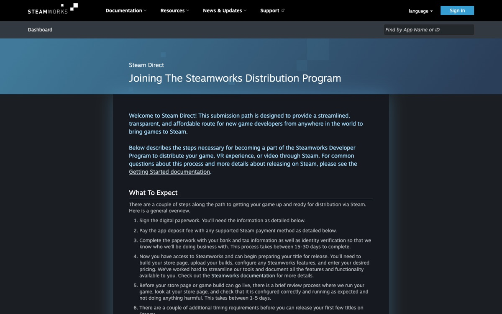
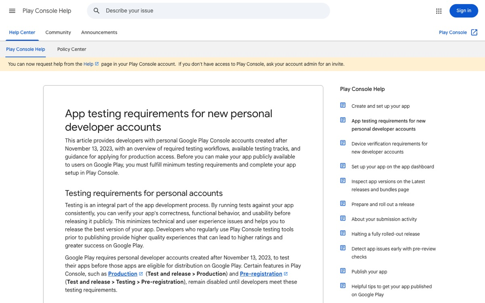
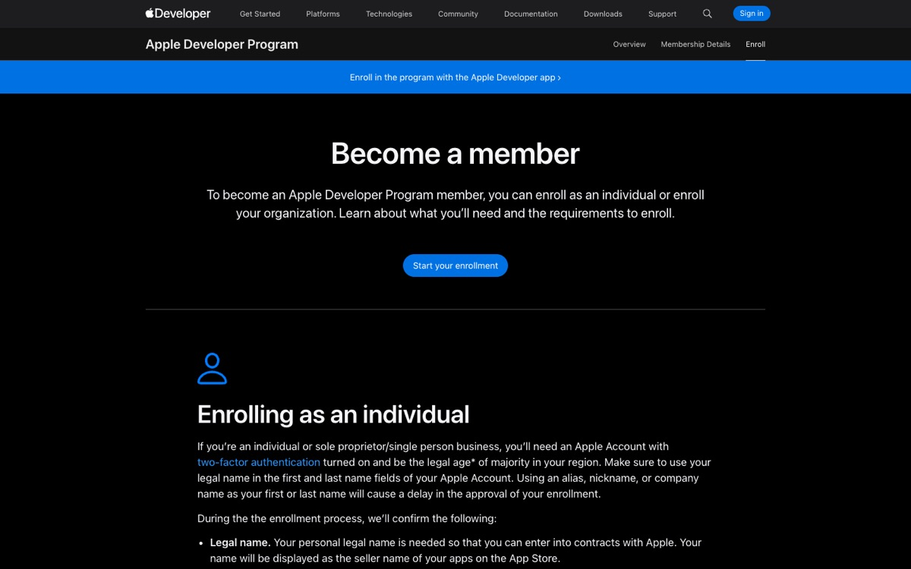
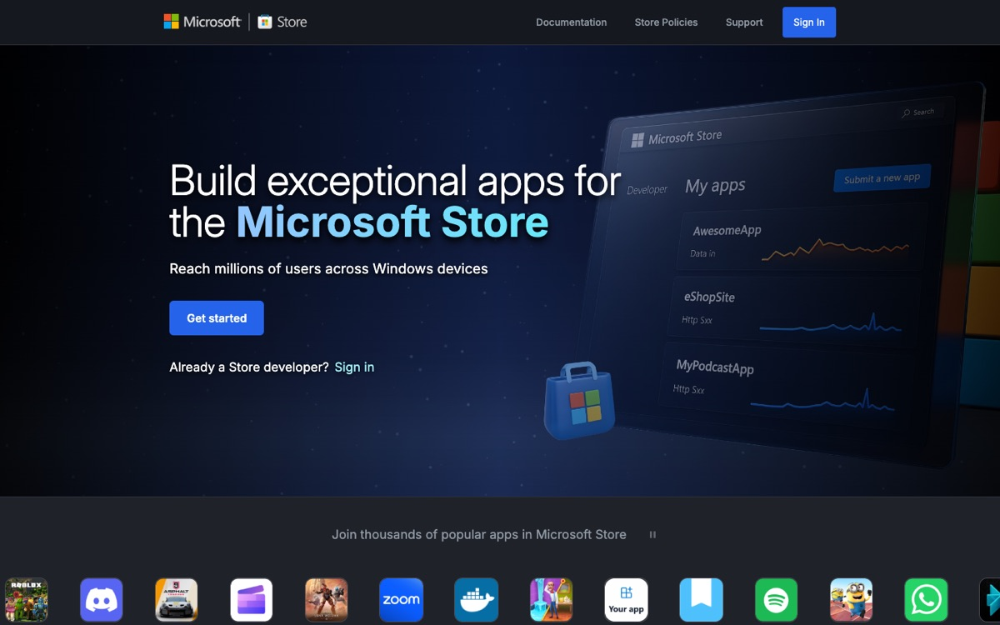
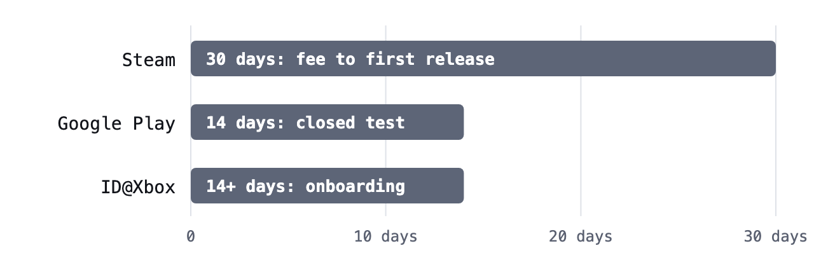
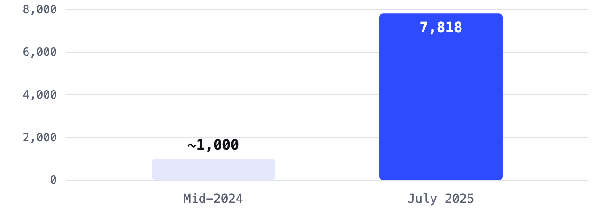
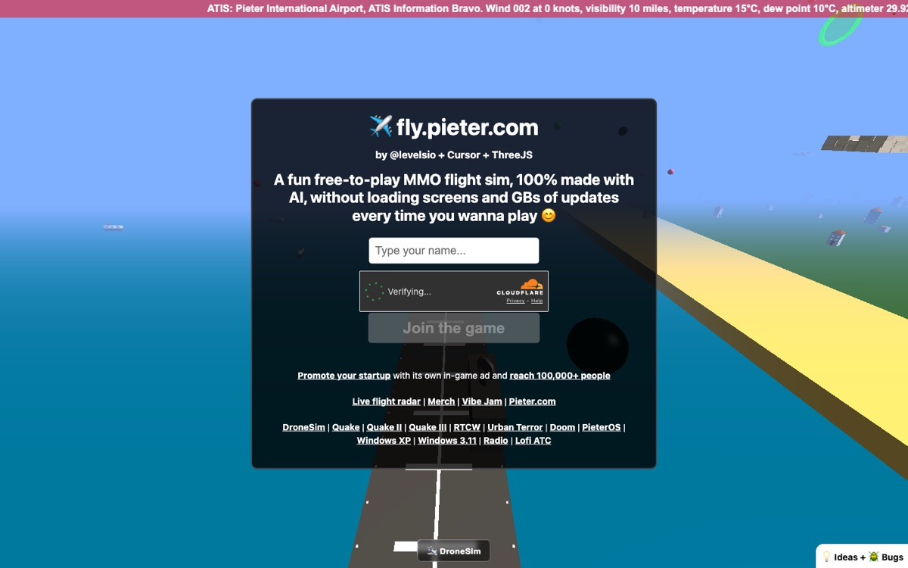
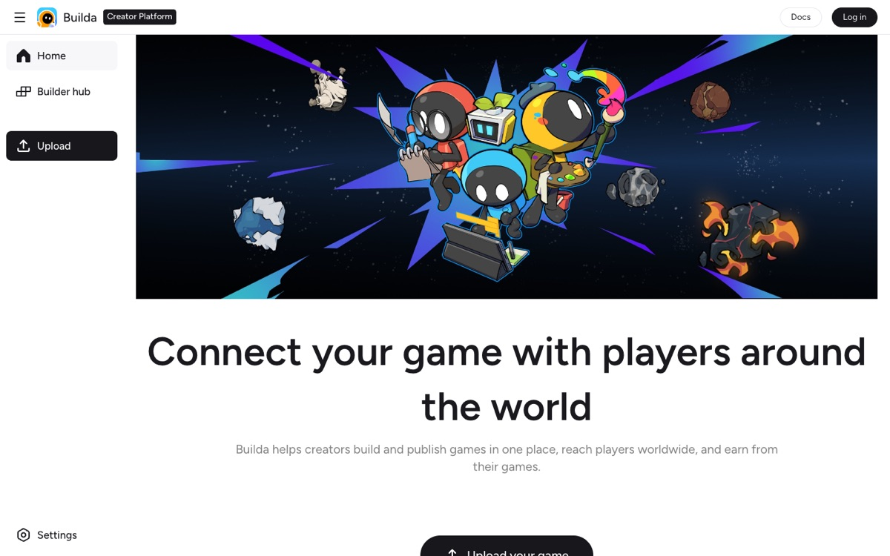
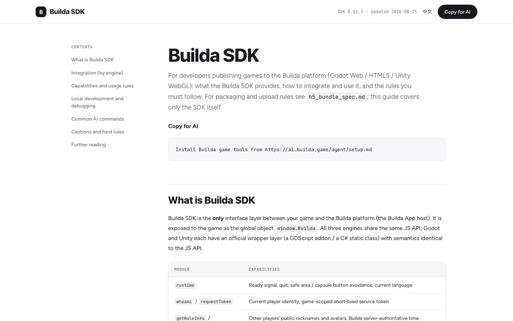

# The gate is open: how AI is rebuilding game development from the bottom up

*For decades, making and publishing a game took money, months of training, and the patience to clear every store’s paperwork. AI has collapsed the first two. The third is changing now.*

Long read · 27 October 2026 · about 15 minutes · [Read the designed web version](https://mzeekaru.github.io/the-gate-is-open/)

Ask anyone who shipped a game before 2023 what the hardest part was, and the answer is rarely the idea. It is everything around the idea. You had to learn an engine. You had to learn to code, or find someone who could. You needed art, sound, and music, which are three more careers. Then, once the game worked, you had to get it past the gatekeepers: store accounts, fees, tax forms, reviews, testers, and waiting periods.

Each step filtered people out. The filter didn’t measure talent. It measured time, money, and access. A teenager with a brilliant design and no laptop, a parent with two free hours a night, or a designer in a country where a $99 yearly fee is a week’s pay could all see the finish line. Very few reached it.

That filter is breaking. This article looks at what the old barriers actually were, what AI changed, what people are building with it right now, and where publishing goes next.

---

**PART 1**

## The gatekeepers: what publishing used to demand

Every major store built its rules for good reasons: fraud, malware, spam, and tax law. But stacked together, those rules became a wall that solo creators had to climb before a single player could try their work. Here is what a first-time individual developer faces today on the big four.

| Store | Cost to start | What stands between you and launch |
|---|---|---|
|  Steam | $100 per game | Identity, bank, and tax paperwork. A 30-day wait between paying the fee and your first release. A public “coming soon” page for at least two weeks. A 1 to 5 day review of your store page and build. |
|  Google Play | $25 once | New personal accounts must run a closed test with at least 12 testers, opted in for 14 days in a row, before they can even apply for production access. |
|  App Store | $99 every year | An Apple Developer Program membership, renewed yearly. Company accounts need a D-U-N-S number, which can take about a week. Every build and update goes through App Review. |
|  Xbox | Free to apply | ID@Xbox asks you to submit a game concept for approval, sign licensing agreements, and order dev kits. Microsoft says to plan for at least two weeks before your development setup is ready. |

**Steam Direct**



**Google Play Console**



**Apple Developer Program**



**Microsoft Store**



*The real front doors. Each one leads to accounts, agreements, and checks before a player sees anything. Screenshots taken 27 October 2026.*

None of these steps is unreasonable on its own. The problem is how they add up for one person. The Google Play rule is a good example. To publish on a new personal account, you need 12 real people to install a test build and stay opted in for two full weeks. If you are a solo creator without a community yet, finding those 12 people can take longer than making the game. Developers have a name for it: the “12-tester tax.”

Steam’s rules ask for patience instead. You pay, then you wait 30 days. Your store page must be public for two weeks before launch. That gives Valve time to confirm who you are, and it gives players time to wishlist your game. It also means the fastest possible first launch on Steam is about a month away from the day you decide to ship.

**Minimum waits for a first-time individual developer**



*These waits come before review time, and they don’t count the time it takes to build the game. Sources: Steam Direct, Play Console Help, Xbox developer docs. Chart made for this article.*

Some doors have opened. In September 2025 Microsoft made Microsoft Store registration free for individual developers, with a quick ID and selfie check instead of a credit card. But that is the exception. The general pattern still holds: the bigger the store, the more paperwork and waiting stand between a finished game and its first player.

---

**PART 2**

## The other wall: you had to become six people

The store wall only mattered if you made it to the end. Most people never did, because of the wall before it: the skills.

A small game needs a surprising number of jobs. Someone designs the rules. Someone programs them. Someone draws characters and backgrounds, animates them, and makes the UI readable. Someone writes music and makes sound effects. Someone tests, finds bugs, and balances the difficulty. Studios hire a person for each of these. A solo developer has to be all of them.

### The engine tax

Before any of that, you choose an engine. **Unity** means learning C# and a large editor full of components, prefabs, and render pipelines. **Unreal** is powerful but expects C++ or its Blueprints visual scripting, plus a capable PC. **Godot** is free and lighter, with its own language, GDScript, and its own way of thinking in scenes and nodes.

All three are excellent tools. All three also take months of learning before most people can build a game loop that feels good: movement that responds well, collisions that don’t break, a camera that follows, menus that work, and a save system that doesn’t lose progress. Tutorials help, but they teach one feature at a time. The hard part is wiring dozens of features together without everything breaking.

This is where most hobby projects die. The idea is fine. The person simply runs out of evenings before the game becomes playable.

---

**PART 3**

## What AI changed: one person, a full team of tools

Generative AI didn’t remove the jobs. It made each job something one person can direct instead of something one person must master. That shift is the whole story.

**Before: the jobs a small game needs**

- Game designer
- Programmer
- 2D or 3D artist
- Animator
- Composer
- Sound designer
- QA tester
- Store and backend admin

**Now: one creator directing tools**

- You: idea, taste, decisions
- Coding agent
- Image and sprite models
- 3D model generators
- Music and SFX models
- AI playtest bots
- AI-ready publishing tools

*The roles don’t disappear. They move from people you hire to tools you direct. Diagram made for this article.*

### Code: from writing it to describing it

The biggest change is in programming. Coding agents such as Claude Code, OpenAI’s Codex, GitHub Copilot, and Cursor don’t just autocomplete a line. They read your whole project, plan a change, edit many files, run the game, read the errors, and try again. You describe the feature you want: “add a double jump with a short cooldown, and show it on the HUD.” The agent writes it in the engine’s language.

That changes who can build. You no longer need to know C# to make a Unity game, or GDScript to make a Godot one. You need to know what you want, test it, and say clearly what feels wrong. Web games became the fastest path of all, because a browser game built with plain JavaScript or Three.js runs instantly. There’s no install and no export step, and the agent can check its own work.

### Art, sound, and testing

The same thing happened to assets. Image models produce sprites, backgrounds, and UI art. 3D generators such as Tripo and Meshy turn a text prompt or a single image into a textured model. Tripo even sponsored the 2026 Vibe Jam. Music and sound models such as Suno and ElevenLabs produce soundtracks and effects in seconds. Developers now also use AI bots to play their games thousands of times and find balance problems that a few human testers would miss.

### How fast it spread

This isn’t a fringe experiment. The numbers moved quickly.

- A Google Cloud survey of 615 developers, run with The Harris Poll in mid-2025, found that **90%** already used AI in their workflows.
- The 2026 GDC State of the Game Industry survey of more than 2,300 professionals found that **36%** use generative AI tools as part of their job.
- On Steam, which asks developers to disclose many kinds of AI-generated content, an analysis by Totally Human found **7,818** games with AI disclosures by July 2025, up from roughly 1,000 a year earlier. That is close to **1 in 5** games released in 2025.
- The r/aigamedev community on Reddit, where creators share AI-made games and workflows, had about **92,000** members by late October 2026, up about 471% in one year, according to GummySearch.

**Steam games that disclose generative AI use**



*Disclosure is voluntary for some uses, so the real number is likely higher. Source: Totally Human analysis of the Steam catalog, reported by Video Games Chronicle. Chart made for this article.*

---

**PART 4**

## The proof: games built in hours, weekends, and days

Claims about AI are cheap. Shipped games aren’t. Here are documented cases from the past two years, from a single evening to a Steam release. Where a number is self-reported, it is marked that way.



*fly.pieter.com describes itself as “100% made with AI.” It runs in a browser tab with no download. Screenshot taken 27 October 2026.*

#### fly.pieter.com · ~3 hours

Pieter Levels, who had no game development background, built a multiplayer flight game in Three.js with Cursor and AI in about three hours, starting 22 February 2025. Levels reported reaching $1M in annual revenue run rate within 17 days, mostly from in-game ads and $29.99 jets. These figures are self-reported.

#### Grumbulus · 2 evenings

Two developers at GonzoML made a browser game where you play a storm cloud wrecking a city. Claude Code wrote about 15,000 lines of plain JavaScript, with procedural audio and parallax effects, and no engine.

#### A roguelike dungeon crawler · 1 weekend

Developer Barret Blake used Claude Code to build a web roguelike with procedural dungeons, turn-based combat, inventory, and several enemy types in about 48 hours.

#### XDA’s cat platformer · 1 weekend

Abhinav Raj at XDA Developers built a Pygame platformer without writing any of the code. It has patrolling pirate-cat enemies, moving platforms, and a retro CRT look. The agent added some polish, such as scanlines and limited ammo, without being asked.

#### Void Balls · 10 days

BigDevSoon ran eight Claude Code agents in parallel and used image and audio models for assets. The result is a bullet-hell platformer with 29,000 lines of C#, 173 scripts, 88 test files, 5 enemy types, and 15 power-ups.

#### Catvivors and CODEX MORTIS · On Steam

AI researcher Przemek Chojecki shipped Catvivors, a $4.99 roguelite with 24 levels, to Steam Early Access in March 2026, built with Claude Code and Codex. The developer of CODEX MORTIS says all its code, sprites, and music were AI-generated. Its free demo drew 10,500 players with 71-minute average sessions and reached Steam’s Popular Upcoming list.

### The jam that made it a movement

Levels then started a game jam with one unusual rule: most of the code had to be written by AI. The 2025 Vibe Coding Game Jam drew about 1,170 entries under an 80% AI rule. First place, worth $10,000, went to Tomas Bencko’s taxi game *The Great Taxi Assignment*. In 2026 the rule rose to 90%, and the results page reports 945 games and more than 1.37 million players.


*Vibe Jam 2026: 945 games and more than 1.37 million players, with at least 90% of each game’s code written by AI. Screenshot taken 27 October 2026.*

Look at what these cases have in common. Almost none of them took months. Many of them are web games. Most of their creators would not call themselves game programmers. And the hard part they describe isn’t the code. It is deciding what is fun, cutting what isn’t, and polishing the feel.

---

**PART 5**

## What AI doesn’t fix

It would be easy to stop the story here. But anyone planning to build this way should know where the new problems are.

- **A prototype isn’t a product.** “Built in three hours” usually means a playable core. Menus, saves, balance, performance on weak phones, and dozens of edge cases still take days or weeks. The XDA writer called AI “a catalyst, but not a crutch.”
- **Sameness.** When everyone uses the same models with similar prompts, games start to look alike. Taste, a clear point of view, and real playtesting are now the scarce skills.
- **Player trust.** In the GDC 2026 survey, 52% of developers said they believe generative AI is harming the industry. Some players avoid games that disclose AI use. Be open about what you used AI for, and make sure the result has care in it.
- **Rights and data.** In the Google Cloud survey, about 63% of developers raised concerns about data ownership. Check each tool’s license for commercial use, and keep your own source files.
- **The discovery problem got worse.** When making a game gets easier, more games get made. Steam alone saw about 19,000 releases in 2025. Building is no longer the bottleneck. Getting in front of players is.

That last point leads to the real question. If one person can now make a game in a weekend, why does publishing it still take a month?

---

**PART 6**

## The last gate: publishing built for the AI era


The old stores were designed for teams with producers, legal help, and a launch calendar. A new kind of platform is being designed for the creator who just finished a game with an AI agent on a Tuesday night. [Builda](https://builda.game/) is one of the clearest examples.

Builda works in two halves. Players use the Builda app on iOS and Android to find and play games, and its Google Play listing shows more than 5 million downloads. Creators publish into that app through the Builda Creator Platform. Your game runs as a web build inside the app, so one upload reaches both phone platforms. You don’t submit a separate app to Apple or Google.



*The Builda Creator Platform. The **Upload** button sits in the sidebar on every page. Screenshot taken 27 October 2026.*

### Made for your AI agent, not only for you

What makes Builda different from older stores is that its tools are written for AI agents to read. The SDK guide has a **Copy for AI** button. It copies a single line that you paste into Claude Code, Codex, or another agent working in your project:

```bash
Install Builda game tools from https://ai.builda.game/agent/setup.md
```

That file is a set of instructions for the agent. It tells the agent to find your project root, detect whether it is Godot, Unity, or HTML5, install Builda’s command-line tools into a `.builda-agent` folder, and run a self-check. From there the agent can add the SDK, test the game, and upload it. The instructions even tell the agent never to ask you for passwords or tokens.



*The Builda SDK guide, with its **Copy for AI** button and the one-line instruction for your coding agent. Screenshot taken 27 October 2026.*

### What a session looks like

Here is a realistic path from idea to upload, based on Builda’s published tools. Your agent does each step in your project:

```bash
# 1. Install the Builda toolchain (the agent follows setup.md)
./.builda-agent/builda check
# 2. Add the SDK: saves, ads, payments, leaderboards
./.builda-agent/builda sdk install
# 3. Test in the browser with a mock Builda app
./.builda-agent/builda dev --web dist
# 4. Sign in once, then upload
./.builda-agent/builda auth
```

Two details matter for people building with AI. First, the SDK has a **mock mode**. It runs the full API in your browser, fakes the player, stores saves locally, and pops up test windows for payments and ads. Your agent can test everything without a phone. Second, every SDK call returns the same `{ ok, data }` or `{ ok, error }` shape and never throws. That kind of predictable interface is easy for an AI to use correctly.

### The hard parts, handled

| Job | Traditional stores | Builda |
|---|---|---|
| Reach phones | Separate iOS and Android builds, two store accounts, two reviews | One web build runs in the Builda app on both |
| Find players | Build your own audience with wishlists and marketing | Your game goes in front of the app’s built-in players |
| Saves and identity | Set up accounts, servers, and sync | Cloud saves and player identity come in the SDK |
| Earn money | Price the game, or integrate ad and payment SDKs yourself | In-app purchases and rewarded video ads through the SDK |
| Multiplayer | Pick, host, and pay for a networking stack | Builda Online, installed with one SDK flag |
| Work with AI | Human dashboards and long forms | Setup files and a CLI written for coding agents |

There are tradeoffs. Your game must run as a web build, so very heavy 3D projects may need trimming. Most players are on phones, and Builda says about 75% of its audience is in East and Southeast Asia, so touch controls and translation matter. Your game lives inside Builda’s app and follows its policies and revenue terms. Read them before you commit. But for the kind of game AI makes fastest, a small, sharp, replayable web game, this path removes almost every gate that stopped people before.

---

**PART 7**

## What this means if you have an idea

The barrier to entry used to be a stack of skills, money, and paperwork. Now it is mostly taste and persistence. That is a better filter, and it is open to far more people.

If you want to try, here is a practical plan:

1. **Start tiny.** Pick one mechanic you can explain in a sentence. A great 5-minute game beats an unfinished epic.
2. **Build for the web first.** Browser games are the fastest for an agent to build and test, and they publish to Builda directly.
3. **Direct, don’t just prompt.** Play every build. Tell the agent exactly what feels wrong: too floaty, too slow, too hard on level 3.
4. **Make it yours.** Use AI for speed, then spend your own time on the parts players remember: the feel, the look, the jokes, the surprise.
5. **Ship early, then listen.** Upload a first version, watch how people play, and improve it every week. Real players are the best playtest bot there is.

For most of gaming history, the question was “can you make a game?” For most people, the honest answer was no. Today the question is “what game do you want to make?” The tools to build it fit in a chat window. And with platforms like Builda, the path to players is no longer a month of waiting. It is a few commands your agent runs for you.

The gate is open. What you build is up to you.

---

**Sources**

- [Steamworks: Steam Direct](https://partner.steamgames.com/steamdirect) (fee, 30-day wait, coming-soon page, review)
- [Play Console Help: testing requirements for new personal accounts](https://support.google.com/googleplay/android-developer/answer/14151465?hl=en-GB)
- [“The 12-tester tax” on Level Up Coding](https://levelup.gitconnected.com/the-12-tester-tax-google-plays-closed-testing-rule-is-quietly-killing-solo-devs-2cea83c2e338)
- [Apple Developer Program enrollment](https://developer.apple.com/programs/enroll/) and [D-U-N-S timing guide](https://magora-systems.com/duns-number-apple-developer/)
- [Xbox developer docs: onboarding](https://devdocs.xbox.com/home/onboarding)
- [Windows Developer Blog: free registration for individual developers](https://blogs.windows.com/windowsdeveloper/2025/09/10/free-developer-registration-for-individual-developers-on-microsoft-store/) (10 September 2025)
- [Google Cloud: 90% of games developers use AI](https://www.googlecloudpresscorner.com/2025-08-18-90-of-Games-Developers-Already-Using-AI-in-Workflows,-According-to-New-Google-Cloud-Research) (18 August 2025)
- [GDC 2026 State of the Game Industry](https://www.businesswire.com/news/home/20260129438528/en/2026-State-of-the-Game-Industry-Report-Reveals-Widening-Effect-of-Layoffs-Broader-Perspectives-on-Generative-AI-Unionization-Tariffs-and-More)
- [Video Games Chronicle: Steam AI disclosures](https://www.videogameschronicle.com/news/steam-games-disclosing-generative-ai-use-are-up-800-this-year/) (Totally Human data)
- [GummySearch: r/aigamedev stats](https://gummysearch.com/r/aigamedev/) (page updated 25 October 2026)
- [levels.io: fly.pieter.com](https://levels.io/full-multiplayer-python-websockets-game-ai) and [404 Media on its revenue](https://404media.co/this-game-created-by-ai-vibe-coding-makes-50-000-a-month-yours-probably-wont)
- [Cinevva: solo devs shipping games with AI](https://app.cinevva.com/news/2026-03-22-solo-devs-shipping-games-with-ai) (Void Balls, Grumbulus, the roguelike, Catvivors, CODEX MORTIS)
- [XDA Developers: a game vibe-coded with Claude Code](https://www.xda-developers.com/i-vibe-coded-a-fully-functional-game-with-claude-code-and-it-doesnt-look-vibe-coded-at-all/) (31 March 2026)
- [Indie Hackers: Vibe Jam 2025 results](https://www.indiehackers.com/post/Uz0wHG4pI3KBOiFhP5YR) and [Vibe Jam 2026](https://vibej.am/2026/)
- [builda.game](https://builda.game/), the [Builda SDK guide](https://ai.builda.game/game-sdk/sdk-guide.en.html), and [Builda agent setup](https://ai.builda.game/agent/setup.md), read 27 October 2026
- Brand icons from Simple Icons; the Microsoft logo is drawn from its official colors. Icons and screenshots belong to their owners. Charts and diagrams made for this article.
